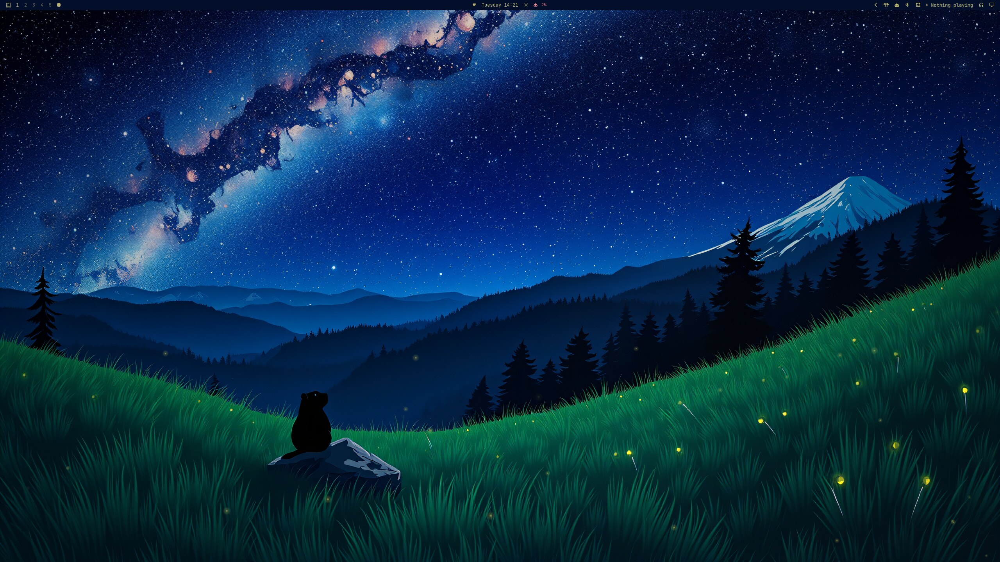
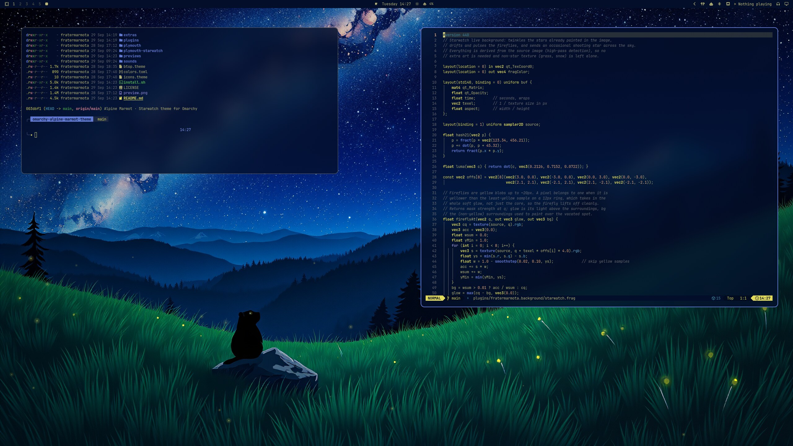
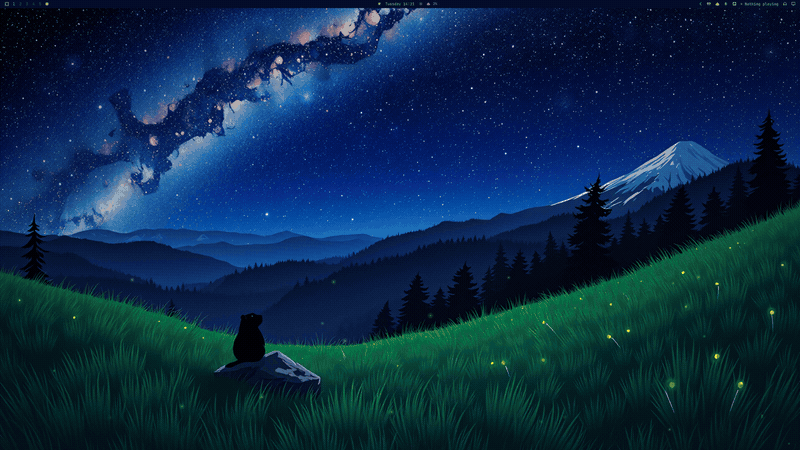
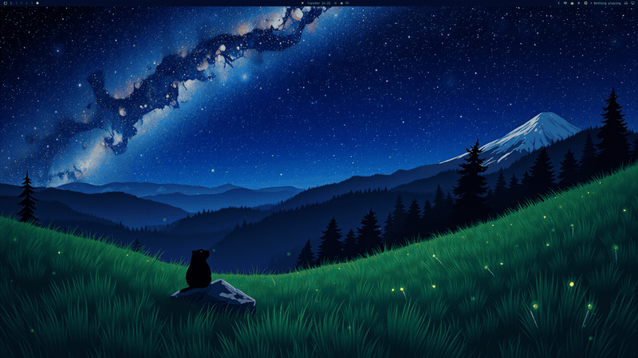
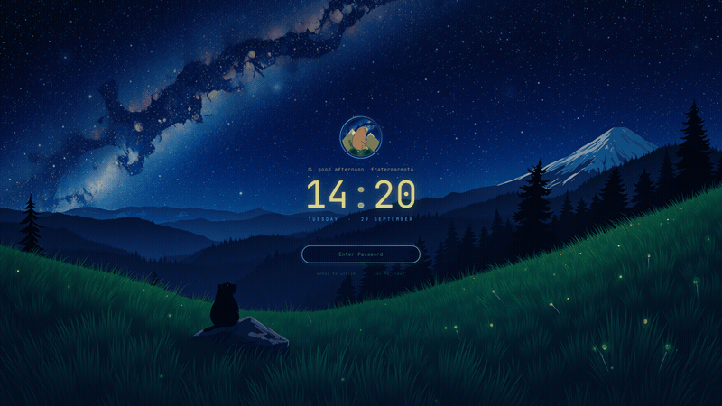
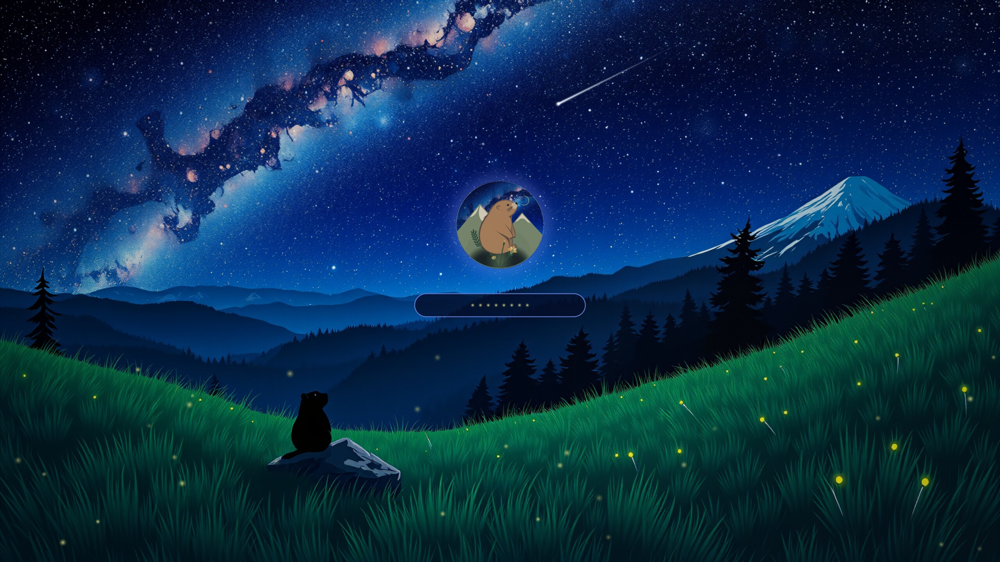
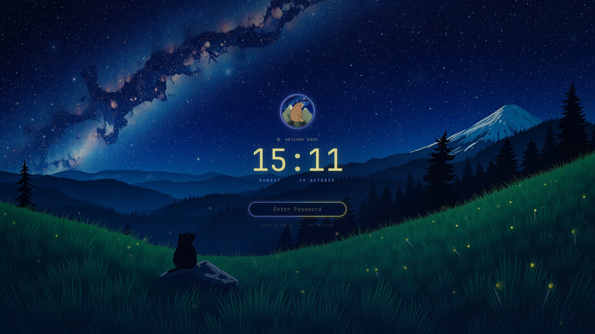
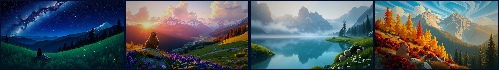

# Alpine Marmot · Starwatch

A night-meadow theme for [Omarchy](https://omarchy.org): a marmot watching the Milky Way, fireflies drifting through the grass. It includes more than colors and a wallpaper. The sky moves, and the lock screen, login intro, login screen, boot splash, mouse cursor and even your clicks all match.

The moving parts come from [Omarchy Living Themes](https://github.com/prostratepossum/omarchy-living-themes), which this theme shares with [Moonlit Hearth](https://github.com/prostratepossum/omarchy-moonlit-hearth-theme). Install both and switch between them (or to any other Omarchy theme) with `omarchy theme set`, and everything changes over to match.





| Live wallpaper | Login intro | Lock screen |
|---|---|---|
|  |  |  |

**Cursors** and **click effects** (fireflies on left click, sparkles on right, a ripple on middle):


**Boot splash** (LUKS password prompt) and **login screen** (SDDM):





**Wallpapers**: Starwatch (animated), Meadow Sunset, Burrow Dawn, Larch Autumn:



## What's inside

| Piece | What it does |
|---|---|
| **Theme** (`colors.toml`, `backgrounds/`, `btop.theme`, `icons.theme`) | The "Starwatch" palette: navy sky, blue accent, firefly-cream text. The palette was pulled from the wallpaper with Aether and the reds/yellows were hand-tuned. Includes 4 wallpapers. |
| **Live wallpaper** (Living Themes) | A GPU shader over the Starwatch wallpaper. Stars twinkle, fireflies drift and pulse in the grass, and a shooting star crosses now and then. Runs at 30 fps and pauses when a window is fullscreen. Other wallpapers stay static. |
| **Lock screen** (Living Themes) | Animated sky with a slow zoom, the marmot badge in a rotating ring, a greeting, a glowing clock, and a password pill with an aurora ring. Fireflies float around and every keystroke throws sparks. Wrong passwords shake red. |
| **Login intro** (Living Themes) | A ~5 s overlay once per boot. The sky fades in, fireflies gather into the badge, then an iris opens onto your desktop. It's click-through, so it never blocks you. |
| **Cursors** (`cursors/`) | A Starwatch XCursor theme: navy arrows with a cream outline and a firefly at the tip. Includes 14 shapes plus aliases, with an animated crescent-moon wait cursor. Anything not drawn falls back to Adwaita. Rebuild with `cursors/build.py`. |
| **Click effects** (Living Themes) | A tiny burst wherever you click: fireflies for left, lavender sparkles for right, a glacier ripple for middle. Click-through, and skipped over fullscreen windows. Needs `python-evdev` and the `input` group (see below). |
| **Login screen** (Living Themes, optional) | The lock screen at the SDDM login: the Starwatch sky, badge, clock and fireflies. Needs sudo once to install; after that it follows your theme. |
| **Boot splash** (`plymouth-starwatch/`) | Animated Plymouth theme with twinkling stars, drifting fireflies, a shooting star and a floating badge. Password bullets are drawn as fireflies. Optional, and needs sudo. |
| **Login chime** (`extras/login.wav`, made by `sounds/`) | A soft synthesized night-meadow chime played at login. Optional. |
| **Keyboard lighting** (`extras/keyboard/`) | Per-key RGB matching the wallpaper rows, with a firefly flash on every keypress. Razer BlackWidow V4 Low Profile TKL via OpenRGB; adaptable to other boards. Optional, manual setup. |
| **Terminal rice** (`extras/`) | Starship prompt, fastfetch marmot logo, lazygit, and eza and fzf colors. They switch in and out with the theme. |

## Install

Requires an up-to-date Omarchy (the Quickshell-based `omarchy-shell`).

```bash
git clone https://github.com/prostratepossum/omarchy-alpine-marmot-theme.git
cd omarchy-alpine-marmot-theme
./install.sh            # theme, cursors, terminal rice + Living Themes (live wallpaper, lock screen, intro, click effects)
./install.sh --all      # ...plus the login chime and the SDDM login screen (asks for sudo)
```

The installer fetches Living Themes (pinned to a release) into `~/.local/share/omarchy-living-themes` and runs its installer. Other options: `--sound`, `--greeter`, `--yes`, `--no-plugins`, `--no-cursors`. `--dotfiles` is no longer needed, since the terminal rice now comes and goes with the theme.

### What switches with the theme

When you run `omarchy theme set`, Living Themes swaps:

- the live wallpaper, lock screen, login intro and login screen (by wallpaper: anything named `*starwatch*` gets the Starwatch sky; other wallpapers stay static)
- the click effects (fireflies for this theme, snowflakes for Moonlit Hearth, none for themes without a scene)
- the mouse cursor, Starship prompt, fastfetch logo, lazygit colors and eza/fzf colors
- the login chime
- the boot splash, through a notification with an **Update boot splash** button, since it needs your password

Pick a theme without a package and your own prompt, cursor and configs come back. Run `living-themes` to see what's active.

### Upgrading from 1.x

1.x shipped its own `starwatch-*` plugins. Run the new `./install.sh` (add `--yes` to skip the question) and it removes them, takes out the old `# >>> starwatch >>>` blocks from `~/.bashrc` and `looknfeel.lua`, and puts back the prompt and lazygit files that `--dotfiles` replaced. The standalone repos (`omarchy-starwatch-background`, `-lock`, `-intro`, `-clicks`) are superseded by Living Themes and won't get updates.

**Just the colors and wallpapers?** Use `omarchy theme install https://github.com/prostratepossum/omarchy-alpine-marmot-theme.git`.

**Click effects setup:** the plugin reads mouse buttons through evdev, so it needs:

```bash
sudo pacman -S python-evdev
sudo usermod -aG input $USER   # then log out and back in
```

The helper keeps only mouse-type devices and only acts on button presses, never keyboard keys or movement. Note that the `input` group lets any program you run read input devices, so skip the click effects if that trade-off isn't for you (`omarchy plugin remove io.github.prostratepossum.living-clicks`).

**Boot splash (optional):**

```bash
living-themes boot                                                             # install (asks for sudo)
~/.config/omarchy/themes/alpine-marmot/plymouth-starwatch/install.sh --revert  # back to stock
```

This rebuilds your initramfs. If the splash ever misbehaves, press **Esc** at boot for the plain text password prompt, then run `--revert`.

## Try it out

```bash
omarchy-shell -q intro play                  # replay the login intro
omarchy-shell lock previewInteractive        # preview the lock screen without locking (closes after 90 s)
omarchy-shell -q background toggleAnimation  # pause/resume the live wallpaper
omarchy-shell -q clicks testButton L         # play a click burst in the middle of the screen (L, R or M)
omarchy-shell -q clicks toggle               # turn the click effects on/off
```

The live wallpaper costs about 8 W of GPU power and ~2% GPU busy on a Radeon RX 9070 XT. Turn it off with the toggle above if you're on battery.

## Uninstall

```bash
omarchy theme set <another-theme>
./install.sh --uninstall                                   # removes this theme and its cursors
~/.local/share/omarchy-living-themes/install.sh --uninstall  # only if no other theme uses Living Themes
```

Removing Living Themes brings back the stock Omarchy background and lock screen, and your own prompt, cursor and configs.

## Notes

- **Keyboard lighting** ([`extras/keyboard/`](extras/keyboard/)): per-key RGB for a Razer BlackWidow V4 Low Profile TKL through OpenRGB. The rows follow the wallpaper, and keypresses flash firefly yellow. It's not installed automatically; see its README for setup and how to adapt it to other keyboards.
- The shaders and plugins live in [Living Themes](https://github.com/prostratepossum/omarchy-living-themes) under `scenes/starwatch/`.
- For a transparent btop like the screenshots, set `theme_background = false` in `~/.config/btop/btop.conf`.

## License

Code: MIT (see `LICENSE`). Artwork (wallpapers, badge, splash images, chime): free for personal use. Please don't resell it or use it in other products without asking.
